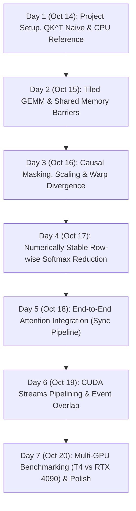

# ROADMAP: NANO_ATTENTION (MIDTERM PREPARATION)

**Target Completion Date**: Tuesday, October 20, 2026 (3 days before exam on Friday, Oct 23, 2026)  
**Timeline**: 7 Days (Oct 14 – Oct 20)  
**Core Goal**: Implement a pure CUDA attention block from scratch to master the 5 core midterm topics:
1. Thread Hierarchy & Warp Divergence (`cuda_structure/`)
2. 2D Mapping & Memory Coalescing (`matrix/`)
3. Shared Memory Tiling & Dual Barriers (`gpu_memory/`)
4. Sequential Tree Reduction (`reduction/`)
5. Pinned Memory, Streams Pipelining & Events (`stream/`)

---

## 7-Day Day-by-Day Execution Plan

---

### Day 1: Wednesday, Oct 14 – Baseline & Infrastructure
- [x] **Midterm Topic**: CUDA indexing basics & memory management (`cuda_structure/`).
- [x] **Milestone**:
  - [x] Implement basic data allocation (`cudaMalloc`, `cudaMemcpy`, `cudaFree`).
  - [x] Wire up CPU reference test harness in `tests/test_matmul.cu` (was test_day1.cu) with synthetic data.
  - [x] Implement naive GEMM ($Q \times K^T$) as a baseline to prove end-to-end data transfer works.
- [x] **Self-Check / Exam Question Check**:
  - [x] *Can you write the 1D and 2D global index equations from memory?*
  - [x] *Are bounds checks (`if (row < M && col < N)`) strictly enforced?*

---

### Day 2: Thursday, Oct 15 – Tiled Matrix Multiplication (`gpu_memory/`)
- [x] **Midterm Topic**: Shared memory tiling, bank conflicts, dual barriers, arithmetic intensity.
- [x] **Milestone**:
  - [x] Implement `matmul_tiled_kernel` in `src/matmul.cu` with `__shared__ float s_A[TILE][TILE]` and `s_B[TILE][TILE]`.
  - [x] Handle both non-transposed ($S \times V$) and transposed ($Q \times K^T$) layouts.
  - [x] Enforce boundary zero-padding for non-multiple-of-tile dimensions.
  - [x] Verify against CPU GEMM.
- [x] **Self-Check / Exam Question Check**:
  - [x] *Why are two `__syncthreads()` mandatory per tile iteration?*
  - [x] *What is the arithmetic intensity improvement over naive GEMM?*

---

### Day 3: Friday, Oct 16 – Scaling, 2D Coalescing & Masking (`matrix/`, `cuda_structure/`)
- [x] **Midterm Topic**: Global memory coalescing (128B bursts) & warp divergence avoidance.
- [x] **Milestone**:
  - [x] Implement `scale_and_mask_kernel` in `src/mask.cu`.
  - [x] Scale scores by $1/\sqrt{d_k}$.
  - [x] Apply causal lower-triangular mask ($j > i \implies -\infty$).
  - [x] Experiment with thread block shapes: compare `(32, 8)` vs `(8, 32)` to observe coalesced access patterns.
  - [x] Test branchless masking to eliminate intra-warp divergence.
- [x] **Self-Check / Exam Question Check**:
  - [x] *Why does block `(32, 8)` outperform `(8, 32)` for row-major access?*
  - [x] *How does intra-warp branching (`tid % 2 == 0`) compare with warp-aligned branching?*

---

### Day 4: Saturday, Oct 17 – Row-Wise Softmax with Tree Reduction (`reduction/`)
- [x] **Midterm Topic**: Tree reduction, sequential addressing, thread coarsening, numerical precision.
- [x] **Milestone**:
  - [x] Implement `softmax_forward_kernel` in `src/softmax.cu`.
  - [x] Step 1: Find row maximum $m = \max_j(x_{ij})$ via sequential tree reduction (`tid < s`).
  - [x] Step 2: Compute $\sum_j \exp(x_{ij} - m)$ via tree reduction.
  - [x] Step 3: Normalize elements: $\exp(x_{ij} - m) / \sum$.
  - [x] Verify floating-point stability (no NaN/inf) against CPU reference.
- [x] **Self-Check / Exam Question Check**:
  - [x] *Why does sequential addressing eliminate warp divergence until `s < 32`?*
  - [x] *Why subtract the row maximum before computing `exp()`?*

---

### Day 5: Sunday, Oct 18 – End-to-End Synchronous Attention
- [x] **Midterm Topic**: Composing kernels, device synchronization, memory workspace management.
- [x] **Milestone**:
  - [x] Assemble the full pipeline in `src/attention.cu`:
    $$\text{Q} \xrightarrow{\text{Tiled GEMM}} QK^T \xrightarrow{\text{Scale+Mask}} S \xrightarrow{\text{Softmax}} P \xrightarrow{\text{Tiled GEMM}} PV = \text{Out}$$
  - [x] Run full test suite across varied batch sizes ($B=1, 2, 4$) and sequence lengths ($N=32, 64, 128$).
  - [x] Ensure zero memory leaks with `cudaMemGetInfo` or `cudaDeviceReset`.
- [x] **Self-Check / Exam Question Check**:
  - [x] *Can you trace the memory footprint of temporary activation buffers?*

---

### Day 6: Monday, Oct 19 – Streams, Pinned Memory & Pipelining (`stream/`)
- [x] **Midterm Topic**: Asynchronous transfers, pinned memory (`cudaMallocHost`), multi-stream concurrency, event timing.
- [x] **Milestone**:
  - [x] Implement `forward_streamed` in `src/attention.cu`.
  - [x] Allocate pinned host memory for $Q, K, V, \text{Out}$.
  - [x] Create multiple CUDA streams (`cudaStreamCreate`) to process heads or batches concurrently.
  - [x] Pipeline chunks: Overlap `H2D(chunk i+1)` with `Compute(chunk i)` and `D2H(chunk i-1)`.
  - [x] Use `cudaEventRecord` and `cudaStreamWaitEvent` for timing and dependencies.
- [x] **Self-Check / Exam Question Check**:
  - [x] *Why does `cudaMemcpyAsync` require pinned (page-locked) memory?*
  - [x] *How do CUDA events measure elapsed time without CPU synchronization stalls?*

---

### Day 7: Tuesday, Oct 20 – Benchmarking & Midterm Readiness Wrap-Up
- [x] **Midterm Topic**: Hardware performance profiling (A100 sm_80, theoretical vs effective bandwidth, roofline model).
- [x] **Milestone**:
  - [x] Run benchmark harness in `benchmarks/bench_attention.cu`.
  - [x] Measure kernel latency (ms) with `GpuTimer` and calculate effective bandwidth (GB/s).
  - [x] Query device hardware properties (`cudaDeviceGetAttribute`) and compute theoretical peak bandwidth.
  - [x] Calculate arithmetic intensity and analyze memory-bound behavior against roofline ridge point.
  - [x] Verify stream speedup vs synchronous baseline and analyze SM saturation effects.
- [x] **Outcome**: Clean, documented repository ready as your ultimate midterm reference!

---

## Buffer / Review Period (Oct 21 – Oct 22)
- **Wednesday, Oct 21**: Review past exam papers and theoretical calculations (Peak BW equation, roofline model).
- **Thursday, Oct 22**: Final mental walkthrough of key kernel code snippets and indexing formulas.
- **Friday, Oct 23 (Exam Day)**: Ace the exam!
